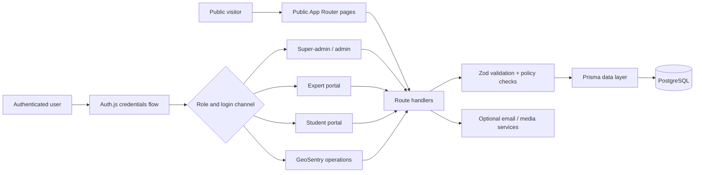

# Architecture

## System shape

Next.js server components read public data through a narrow selection layer in `lib/public-data.ts`. Route handlers own mutations and authenticated data access. Prisma provides the schema, generated client, and migration boundary; the repository contains schema and migrations but no records.

## Authorization model

Five roles are represented in the schema: `SUPERADMIN`, `ADMIN`, `EXPERT`, `GEOSENTRY_MANAGER`, and `STUDENT`. Authentication also separates staff and user login channels. A valid password alone is not meant to grant access through the wrong channel, and server routes must continue to enforce role checks even when navigation hides a page.

Account records track failed attempts and lockout state. Successful and failed authentication events can enter the audit log. In-memory rate limiting is suitable only for local/single-process evaluation; production serverless or multi-instance deployment requires a shared store such as Redis.

## GeoSentry domain

GeoSentry models a geological screening request from intake through review, quality control, completion, delivery, revision, hold, cancellation, or refund states. Deposit types, priorities, verdicts, target/client geography, assignments, and activity history are structured. The product language describes a 100-point framework, but the software does not make an autonomous investment decision.

## Failure behavior

Public list/statistic helpers catch database failures and return empty states so the marketing shell can still render. Operational routes should fail explicitly and must not silently claim that a mutation succeeded. Email is optional; a deployment must define what happens when delivery is unavailable.

## Security boundary

- HTTP security headers are defined in middleware/configuration.
- Password hashes use bcrypt; raw passwords must never enter logs or source control.
- Upload checks currently validate declared type and size. A real deployment still needs storage isolation, content inspection, and malware scanning.
- Unauthenticated application-level rate limits are memory-local and not a distributed defense.
- Database access, backups, email, uploads, and session secrets are deployment responsibilities.

See [Security](../SECURITY.md) and [Deployment](DEPLOYMENT.md).
